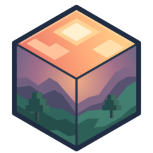

# Immersive Panoramas

Custom 360° main menu panoramas captured directly from your worlds and servers.

---

### What does it do?

This mod changes your title screen background to a 360° panorama of where you were standing when you left your world or server.

When you disconnect, it captures the area from your exact location and camera angle, turning your last play session into the new main menu background.

**[▶ Watch Showcase on YouTube](https://www.youtube.com/watch?v=Hy0773L7jyA)**

---

### Features

- **Exact view alignment**: Saves your camera angle so the main menu panorama points right where you were looking.
- **Vanilla style**: Uses Minecraft's standard menu blur and dimming so it feels like part of the base game.
- **World & server rules**: Allow or block specific singleplayer worlds and multiplayer servers in the config menu.

---

### In-Game Configuration

Open the config menu using [Mod Menu](https://modrinth.com/mod/modmenu) on Fabric/Quilt, or via the **Mods** list on Forge/NeoForge:

| Setting                 | Description                                                                                                     |
| :---------------------- | :-------------------------------------------------------------------------------------------------------------- |
| **Enable Panoramas**    | Turn panorama captures on or off.                                                                               |
| **Resolution**          | Choose Auto or a fixed resolution for each of the six faces. Hover over the setting for its GPU cost.           |
| **List Mode**           | Switch between Allow List (only capture listed worlds) or Block List (capture everywhere except listed worlds). |
| **World & Server List** | Select which singleplayer worlds or servers to include or skip.                                                 |

#### Capture resolution

**Auto** is the default. It picks a resolution from 1024 to 1536 pixels per face based on framebuffer height and field of view.

| Preset  | Resolution per face | GPU readback buffer |
| :------ | :------------------ | ------------------: |
| Auto    | 1024–1536 px        |           24–54 MiB |
| 1024 px | 1024 × 1024         |              24 MiB |
| 1536 px | 1536 × 1536         |              54 MiB |
| 2048 px | 2048 × 2048         |              96 MiB |

Higher resolutions can preserve more detail and take longer to capture when you leave a world or server, especially with shaders. The buffer sizes cover readback for all six faces. Resolution changes apply the next time you capture a panorama.

---

### Installation & Compatibility

- **Download**: Grab the latest release on [Modrinth](https://modrinth.com/mod/immersive-panoramas) for your loader.
- **Supported Loaders**: Fabric, Quilt, Forge, and NeoForge.
- **Client-Side Only**: Works everywhere! You can freely join any server even if the mod isn't installed on it.

#### Shader compatibility

Panoramas can capture your world with [Iris](https://github.com/IrisShaders/Iris) shaders active. A limited set of packs and presets have been tested, so you may see seams, uneven lighting, or blur with other setups.

Photon's vignette is skipped during capture to prevent dark edges where the panorama faces meet. Your vignette setting still applies during gameplay.

If you run into a problem, please [open an issue](https://github.com/ersidev/ImmersivePanoramas/issues) and include the shader pack name, version, and preset, plus a screenshot if you have one.
